<!-- Upload README.md and the assets folder together. -->

  

  <a href="#languages">LANGUAGES</a> &nbsp; / &nbsp;
  <a href="#interests">INTERESTS</a> &nbsp; / &nbsp;
  <a href="#unesco">UNESCO</a>

Exploring code, financial markets, and machine learning. Punjabi roots. Sikh identity. Always learning.

Languages

  
  
  
  
  
  

Interests

<strong>↗ Stocks &amp; trading</strong>

Interested in financial markets, price action, and the patterns behind the charts.

<strong>⌘ Code &amp; machine learning</strong>

I code in HTML, CSS, Java, JavaScript, C++, and Python. I’m especially interested in machine learning and exploring what I can build with it.

UNESCO

  

